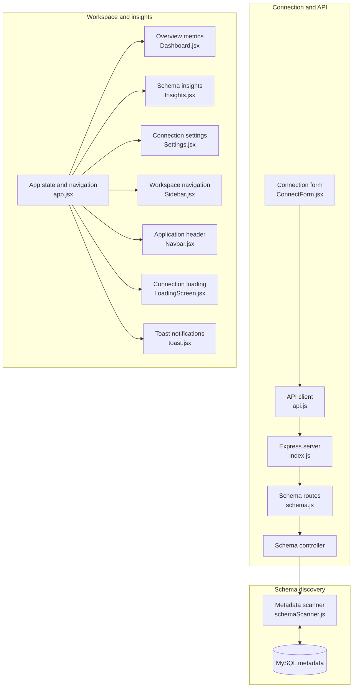

# SchemaLens

**Visualise any MySQL database in seconds.** Connect to a database and SchemaLens turns its tables, columns and foreign keys into an interactive, draggable schema diagram, with search, insights and PDF export.

## Features

- **Interactive schema graph** - every table is a draggable card; foreign keys are drawn as elbow lines that attach to the exact column on both sides.
- **Click to highlight** - select a table to spotlight it and the tables it is linked to, with the rest dimmed and the connecting lines animated.
- **Pan, zoom and minimap** - zoom controls, fit-to-view and a minimap for large schemas.
- **Table Explorer** - an accordion list of all tables; expand one to see every column with its type, primary / foreign key badges, nullability and the table it references.
- **Relationships view** - a searchable list of every foreign key, with a "View in Graph" shortcut that jumps to the table on the canvas.
- **Overview with real insights** - total tables, relationships and columns, plus most connected tables, largest tables, and tables that need attention (no relationships or no primary key).
- **Live search** - filter tables by name across the graph and the explorer.
- **Export to PDF** - download the full diagram.
- **Settings** - view the current connection details and disconnect.
- **Polished experience** - animated connection screen, toast notifications, dark theme and consistent icons.

## Tech Stack

| Layer | Technology |
|---|---|
| Frontend | React 19, Vite |
| Graph | React Flow (`@xyflow/react`) |
| Icons | lucide-react |
| Export | html-to-image, jsPDF |
| HTTP client | Axios |
| Backend | Node.js, Express |
| Database access | mysql2 (reads `information_schema`) |

## 🏗️ Architecture

Generated by [GitDiagram](https://gitdiagram.com/kanishka373/schemalens).




### Prerequisites

- Node.js 18 or newer
- A running MySQL server you can connect to

### 1. Clone the repository

```bash
git clone https://github.com/<your-username>/schemalens.git
cd schemalens
```

### 2. Start the backend

```bash
cd backend
npm install
npm run dev
```

The API runs on `http://localhost:5000`. Create a `backend/.env` file if you want a different port:

```
PORT=5000
```

### 3. Start the frontend

In a second terminal:

```bash
cd frontend
npm install
npm run dev
```

Open the URL Vite prints (usually `http://localhost:5173`). Requests to `/api` are proxied to the backend automatically.

### 4. Connect

Enter your MySQL host, port, user, password and database name, then click connect.

## API

| Method | Endpoint | Description |
|---|---|---|
| `POST` | `/api/connect` | Test the connection with the given credentials |
| `GET` | `/api/tables` | Tables with their columns, types and keys |
| `GET` | `/api/relationships` | All foreign key relationships |
| `GET` | `/api/stats` | Summary counts for the overview |

## Project Structure

```
schemalens/
├── backend/
│   ├── index.js              # Express server
│   ├── routes/schema.js      # URL -> controller mapping
│   ├── controllers/          # Request handling
│   └── services/             # information_schema queries
└── frontend/
    └── src/
        ├── app.jsx           # App shell and section routing
        ├── components/       # Graph, table cards, explorer, sidebar...
        └── services/api.js   # API calls
```

## Security Notes

- Database credentials are used only to open a connection for the current session and are not stored by the app.
- For safety, connect with a **read-only** MySQL user. SchemaLens only reads schema metadata.


## Future Scope

- [ ] User signup
- [ ] User login
- [ ] Connection history

## License

This project is for learning and portfolio purposes.